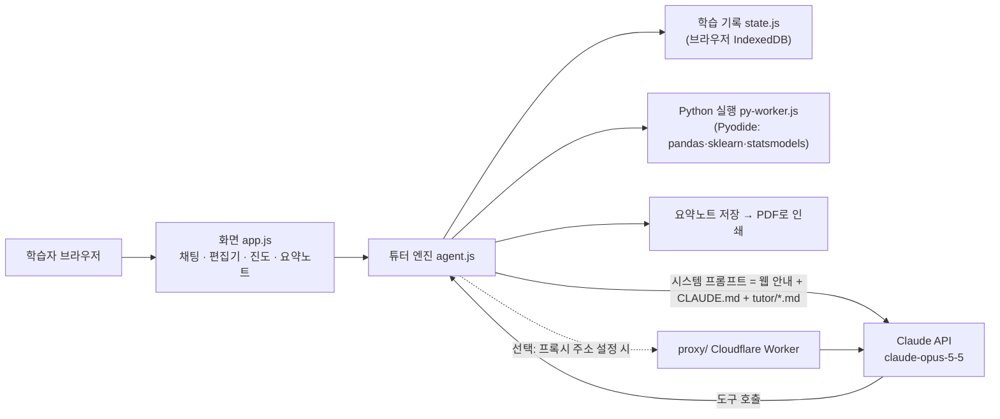
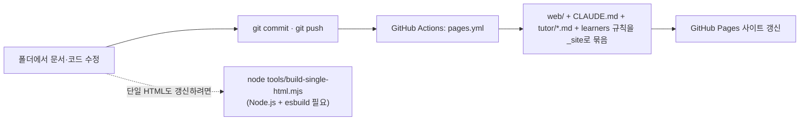

# 빅분기 실기 튜터 · 웹 버전 아키텍처

2026-11-25 기준 · 저장소 [yoon9563-web/bigdataexamtutor](https://github.com/yoon9563-web/bigdataexamtutor) · 사이트 <https://yoon9563-web.github.io/bigdataexamtutor/>

폴더용 튜터(Claude Code·Codex가 md 규칙을 읽고 수업하는 구조)는 [bigdata-tutor-architecture.md](bigdata-tutor-architecture.md)에 정리돼 있다. 이 문서는 그 규칙을 그대로 웹에서 돌리기 위해 추가한 부분을 설명한다.

## 폴더 트리

```text
빅데이터분석기사/
├── AGENTS.md                      Codex 진입점 (CLAUDE.md로 연결)
├── CLAUDE.md                      튜터 수업 규칙의 시작점 ★ 웹 튜터도 그대로 읽음
├── README.md                      폴더 버전 사용법
├── bigdata-tutor-architecture.md  폴더 버전 아키텍처
├── ARCHITECTURE-WEB.md            이 문서 (웹 버전 아키텍처)
├── .gitignore                     개인 학습 기록(learners/<ID>/)·notes/ 업로드 제외
│
├── tutor/                         ★ 수업 규칙 문서 (웹 튜터의 시스템 프롬프트로 사용)
│   ├── workflow.md                진단·계획·출제·힌트·채점·진도 규칙
│   ├── curriculum.md              시험 형식과 1·2·3유형 개념 지도
│   ├── type1-index.md             데이터마님 1유형 120문항 개념 색인
│   ├── summary-notes.md           요약노트 수집·발행 규칙
│   ├── youtube-research.md        영상 자료 반영 기준
│   └── recent-exam-patterns.md    최근 실기 영상 색인
├── learners/
│   ├── README.md                  state.json 구조·저장 규칙 (웹에서 검증 기준으로 사용)
│   └── state.template.json        신규 학습자 기록 틀
│
├── web/                           웹사이트 (빌드 없이 그대로 배포)
│   ├── index.html                 화면 뼈대
│   ├── README.md                  웹 버전 사용·배포 설명
│   ├── css/style.css              디자인 (라이트·다크, 모바일)
│   ├── js/
│   │   ├── app.js                 화면 연결: 채팅, 학습자 선택, 편집기, 진도, 요약노트, 설정, 백업
│   │   ├── agent.js               튜터 엔진: Claude API 호출 + 도구 실행 반복
│   │   ├── prompt.js              규칙 문서를 읽어 시스템 프롬프트 생성
│   │   ├── state.js               학습 기록 저장·검증·진도 계산·백업
│   │   ├── python.js              Python 실행 관리 (제한 시간, 재시작)
│   │   ├── py-worker.js           Pyodide를 돌리는 백그라운드 작업자
│   │   ├── kv.js                  브라우저 저장소(IndexedDB) 도우미
│   │   └── config.js              기본 설정 (모델, 프록시 주소 등)
│   └── vendor/                    외부 라이브러리 묶음
│       ├── anthropic-sdk.mjs      Anthropic SDK 1.6.0
│       ├── marked.mjs             Markdown → HTML
│       └── purify.mjs             HTML 안전 처리 (DOMPurify)
│
├── dist/
│   └── bigdata-tutor.html         파일 하나 버전 (더블클릭으로 실행, 제출·공유용)
├── tools/
│   └── build-single-html.mjs      web/ + 규칙 문서 → dist/bigdata-tutor.html 생성
├── proxy/                         (선택) 운영자 API 키를 숨기는 중계 서버
│   ├── cloudflare-worker.js
│   └── README.md
└── .github/workflows/
    └── pages.yml                  main에 push하면 GitHub Pages로 자동 배포
```

## 한눈에 보는 구조



세 층으로 나뉜다.

| 층 | 하는 일 | 파일 |
|---|---|---|
| 규칙 | 무엇을 어떻게 가르칠지 정함. 폴더 버전과 같은 문서 | CLAUDE.md, tutor/*.md, learners/README.md |
| 엔진 | 규칙을 Claude에게 넘기고, Claude가 요청한 작업(기록 저장, 코드 실행 등)을 브라우저에서 대신 수행 | agent.js, prompt.js, state.js, python.js |
| 화면 | 학습자가 대화하고 코드를 실행·제출하고 진도·노트를 봄 | index.html, app.js, style.css |

규칙 문서만 고쳐도 웹 튜터의 수업 방식이 바뀐다. 코드는 건드릴 필요가 없다.

## 한 번의 질문이 처리되는 흐름

1. 학습자가 메시지를 보내면 엔진이 앞에 현재 학습 ID와 오늘 날짜를 붙여 Claude API로 보낸다.
2. Claude는 규칙 문서대로 답하면서 필요한 도구를 부른다. 예: 기록 읽기 → 정답 계산 → 문제 출제 → 기록 저장.
3. 엔진은 도구를 브라우저에서 실행하고 결과를 다시 Claude에게 보낸다. 도구 호출이 끝날 때까지 반복한다(최대 24번).
4. 답은 글자 단위로 화면에 흘러나오고, 대화와 기록은 매 단계 브라우저에 저장된다.

## 튜터가 쓰는 도구 (폴더 작업 → 웹 도구)

| 폴더 버전에서 하던 일 | 웹 도구 | 비고 |
|---|---|---|
| `learners/<ID>/state.json` 읽기 | get_state | 다른 학습자 기록은 열지 않음 |
| 새 학습 ID 발급 | create_learner | 기존 ID와 겹치면 거절 |
| 기존 ID로 이어 하기 | open_learner | 이 브라우저에 없으면 백업 가져오기 안내 |
| state.json 갱신 | update_state / save_state | 저장 전 구조·ID 참조·상태값·힌트 0~3 검증, 실패 시 저장 안 함 |
| Python으로 정답 계산·채점 | run_python | "tutor" 공간(학습자에게 안 보임)과 "learner" 공간(편집기와 공유) 분리 |
| 요약노트 md·pdf 저장 | save_summary_note | 요약노트 탭에서 "PDF로 저장" (브라우저 인쇄, 한글 글꼴) |

## 데이터는 어디에 저장되나

| 데이터 | 위치 | 옮기는 법 |
|---|---|---|
| 학습 기록, 대화, 요약노트 | 사용하는 브라우저의 IndexedDB | 상단 "백업"에서 JSON 내보내기·가져오기 |
| API 키·설정 | 브라우저 localStorage | 각 브라우저에서 다시 입력 |
| 튜터 규칙 문서 | 사이트: 배포 때 `knowledge/`로 복사 / 단일 파일: HTML 안에 포함 | 문서 수정 후 push 또는 다시 빌드 |

서버에 저장되는 것은 없다. 같은 사람이라도 사이트와 단일 HTML 파일, 또는 다른 브라우저 사이에서는 기록이 따로다.

## 실행 형태 세 가지

| 형태 | 여는 법 | 용도 |
|---|---|---|
| GitHub Pages 사이트 | 위 사이트 주소 | 평소 사용, 공유 |
| 단일 HTML | `dist/bigdata-tutor.html` 더블클릭 | 제출, 오프라인 전달 (인터넷 연결은 필요) |
| 로컬 미리보기 | 폴더에서 `python -m http.server 8000` → `http://localhost:8000/web/` | 코드·문서 수정 확인 |

## 배포 흐름



배포본에는 `learners/README.md`와 `state.template.json`만 들어가고 개인 기록은 들어가지 않는다.

## API 키와 비용

- 기본: 사용자가 설정 창에 자기 Anthropic API 키를 넣는다. 브라우저에서 Claude API를 직접 호출하고 비용은 각자 부담한다.
- 선택: 운영자가 `proxy/`의 Cloudflare Worker에 키를 넣어 두면, 사용자는 설정에 프록시 주소(와 접속 코드)만 넣으면 된다. 비용은 운영자 부담이다.
- 기본 모델은 claude-opus-5-5, 사고 깊이 medium. 응답이 안전 분류기에 거절되면 다른 모델로 자동 재시도(설정에서 끌 수 있음). 반복되는 규칙 문서는 프롬프트 캐싱으로 비용을 줄인다.

## 폴더 버전과의 차이·한계

- 유튜브 영상 검토와 영상 색인 갱신은 웹에서 하지 않는다. 폴더 버전에서 진행한다.
- Python은 브라우저 안에서만 돈다. 인터넷 접근은 없고, 시험 데이터 파일은 편집기의 "파일 올리기"로 넣는다. 90초가 넘는 실행은 중단되고 환경이 초기화된다.
- 처음 Python을 쓸 때 실행 도구를 내려받느라 30초 정도 걸린다.
- 브라우저 데이터를 지우면 학습 기록이 사라진다. 백업을 권장한다.
