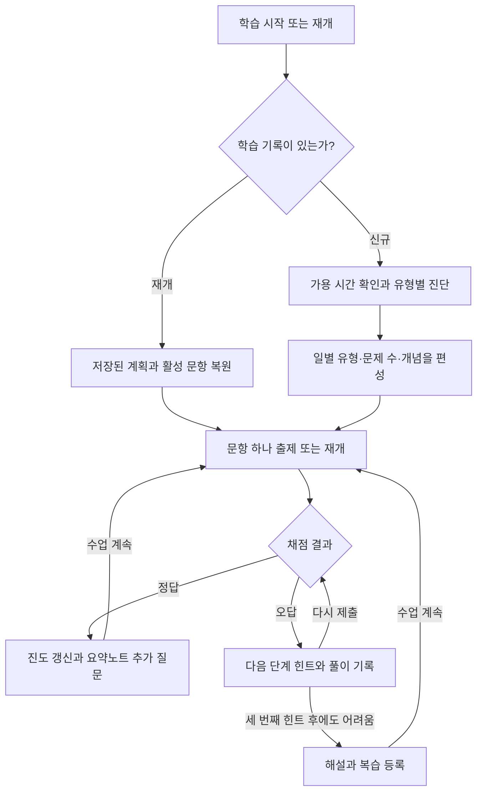

# 빅데이터분석기사 실기 튜터 아키텍처

2026-11-25 기준 · 확인한 프로젝트 위치는 `C:\Users\aicam\Desktop\빅데이터분석기사`다.

## 수정 ZIP 적용 후 폴더 트리

```text
빅데이터분석기사/
├── AGENTS.md                 Codex 진입점. CLAUDE.md를 읽도록 연결
├── CLAUDE.md                 Claude Code 진입점. 수업·요약노트·영상 검토 지침 연결
├── README.md                 사용법과 프로젝트 개요
├── bigdata-tutor-architecture.md  프로젝트 구조와 구동 흐름을 설명하는 참고 문서
├── tutor/
│   ├── curriculum.md         시험 형식과 1·2·3유형 개념 지도
│   ├── type1-index.md        데이터마님 1유형 1~120번 개념·함수 색인
│   ├── youtube-research.md   영상 근거 검증과 분석 보류 자료의 수업 반영 제외 규칙
│   ├── recent-exam-patterns.md  영상별 확인 상태·근거·검증된 개념 색인
│   ├── workflow.md           진단·계획·출제·채점·힌트·진도 규칙
│   └── summary-notes.md      요약노트 수집·PDF 발행 규칙
└── learners/
    ├── README.md             학습자별 저장 및 재개 규칙
    └── state.template.json   신규 학습자 기록 양식
```

학습 중 생성되는 경로는 `learners/<학습ID>/state.json`과 `learners/<학습ID>/notes/summary-notes-YYYY-MM-DD.{md,pdf}`다. 개인 기록 없이 공통 노트를 요청하면 프로젝트의 `notes/` 아래에 저장하도록 되어 있다.

수업 계획을 만들거나 갱신할 때 `CLAUDE.md`에서 `tutor/youtube-research.md`를 읽고, `tutor/recent-exam-patterns.md`의 확인 상태와 근거를 점검한다. 확인된 개념만 커리큘럼 편성과 출제에 참고한다.

## 사용하는 자료

| 자료 | 튜터가 사용하는 방식 |
|---|---|
| 데이터마님 분석보고서에서 옮긴 1유형 색인 | 번호별 개념과 함수 후보를 보고 문제를 고르고, 필터·정렬 외에도 날짜·문자열·결측·표 변환 등 아직 안 푼 개념을 편성한다. |
| 공개 실기 안내와 데이터마님 동형 패턴 | `curriculum.md`의 시험 구조와 작업형별 개념을 바탕으로 남은 시간에 맞춰 실습을 배분한다. 2유형 지표와 제출 조건은 실제 문항에서 확인한다. |
| 학습자의 잔여 공부일·가용 시간·목표·진단 답안 | 신규 학습자의 유형별 수준과 일일 문제 수를 결정한다. |
| 학습자별 `state.json` | 완료 문항, 활성 문항, 힌트 단계, 개념별 학습 근거, 요약노트 제안 및 발행 기록을 읽어 다음 수업을 이어간다. |

유료 문제는 학습자가 직접 접근하거나 제공한 범위에서 사용한다. 원문을 사용할 수 없으면 튜터가 같은 개념의 가상 데이터 문제를 만든다. 원본 분석보고서와 문제 본문은 위 폴더 트리에서 확인된 파일에 포함되어 있지 않다.

## 한 번의 수업이 흐르는 방식



- 진단과 개념 지도를 바탕으로 **날짜별 1·2·3유형 문항 수, 개념, 예상 시간**을 보여준다. 실제 문제는 하나씩 공개한다.
- 오답 시 **풀이 방향 → 중간 결과 → 빈칸 코드** 순서로 힌트를 하나씩 준다. 세 번째 힌트 뒤 한 번 더 풀 기회를 제공한다.
- 문항을 마치면 진행률과 독립 정답·도움 후 정답·해설 완료를 갱신한다. 정답일 때는 “방금 푼 문제의 개념을 요약노트에 정리해드릴까요?”라고 묻고 답변을 기다린다.

## 요약노트가 만들어지는 방식

마지막 공부일을 마무리하거나 사용자가 요청하면 AI가 학습 기록과 요약노트 규칙을 읽어 Markdown을 작성한다. 실행 환경의 PDF 도구로 변환하고, 한글과 코드가 제대로 보이는지 확인한 뒤 PDF를 전달하도록 되어 있다.

| 구성 | 들어가는 내용 |
|---|---|
| 1유형 | 오답·힌트·해설이 필요했던 코드와 사용자가 정리 요청한 개념. 풀이 근거가 없으면 색인 120문항 전체의 코드 패턴을 중복 없이 정리 |
| 2유형 | 이진분류·다중분류·회귀 각각의 풀이 순서와 필수 코드. 전처리·검증·예측·CSV 저장 및 확인을 포함 |
| 3유형 | t검정, 카이제곱, 분산분석, 상관, 회귀 등 주요 통계 코드와 통계량·p값·계수 확인법 |

## 실행 전제와 확인 범위

바탕화면 프로젝트에서 `CLAUDE.md`의 요약노트 연결과 `tutor/summary-notes.md` 파일을 확인했다. Codex 또는 Claude Code가 작업 폴더의 문서를 읽고 학습 상태를 쓸 수 있어야 한다. 별도의 실행 앱, 채점 프로그램, PDF 변환 스크립트가 폴더에 들어 있는 구조는 아니다. 마지막 날 자동 발행은 AI가 수업을 처리하는 중에 발동하며, 접속이 없으면 다음 수업에서 처리한다. 이 문서 작성 중 실제 수업 재개나 PDF 발행까지 실행해 검증하지는 않았다.

## 최근 기출 영상 자료


- [퇴근후딴짓 @ai-study](https://www.youtube.com/@ai-study)를 우선 검색한다. 비슷한 주제의 새 영상은 유튜브 전체에서도 찾는다. 검색어는 빅데이터분석기사 실기, 빅분기 실기, 기출 분석, 복원, 해설, 작업형을 조합한다.
- 12회부터(12회 포함) 실제로 다룬 실기 회차를 기록한다. 업로드일, 분석 대상 회차, 대비 회차를 구분한다. 필기, 접수, 단순 홍보를 제외한다.
- 주간 검색 결과 또는 사용자가 제공한 링크를 받으면 영상 ID로 중복을 제거한다. 접근 가능한 자막·설명·챕터·공개 연결 자료에서 확인된 내용을 요약한다. 타임스탬프가 있으면 기록한다. 제목만 확인되면 분석 보류 상태로 등록하고 개념은 비워둔다.
- 각 항목에는 영상 ID·링크·채널·업로드일·분석 회차·대비 회차·작업형·개념·근거·확인 상태를 기록한다. 공식 자료, 복원·후기, 대비·경향 분석을 출처에 따라 표시한다. 같은 원자료를 인용한 영상은 독립 근거로 세지 않는다.

## 수업 반영

링크나 주간 검색 결과를 전달받으면 위 기준으로 검토하고 [최근 실기 영상 색인](tutor/recent-exam-patterns.md)을 갱신한다. 수업 계획·재계획 때 색인의 확인된 개념을 읽고, 학습 기록에서 독립 풀이 근거가 약한 개념을 미완료 일정에 가상 데이터 변형으로 배정한다. 확인 보류인 영상은 출제 근거에서 제외한다. 시험 배점·규격은 공식 안내와 해당 문항 지시를 우선한다.

주간 검색은 별도 예약 작업이 수행하며, 새 영상이 있을 때 반영용 Markdown을 전달한다. 프로젝트 폴더 반영은 폴더에 쓰기 권한이 있는 튜터 세션에서 결과를 받아 수행한다.

## 분석 보류 자료 처리

- 분석 보류·미확인 상태인 파일, 영상, 링크는 재검토할 수 있도록 출처, 보류 사유, 확인이 필요한 항목을 기록한다. 제목·파일명·검색 요약만으로 작업형, 개념, 출제 빈도나 중요도를 추정하지 않는다.
- 보류 자료는 커리큘럼의 개념·우선순위, 학습 일정과 유형별 문항 배분, 출제·채점·해설·요약노트의 근거에서 제외한다. 파일이 프로젝트 폴더에 추가되거나 주간 검색 결과에 다시 나타나도 같은 기준을 적용한다.
- 원문, 자막, 또는 연결된 공개 자료에서 해당 작업형과 개념을 확인하고 근거 위치를 색인에 남긴 뒤, 확인된 항목만 수업 계획에 반영할 수 있다. 예를 들어 현재 색인의 `O08cdG8Wpl4`는 제목과 범위만 확인됐으므로 세부 작업형과 개념은 보류한다.

## 폴더에 추가하는 방법

이 문서는 프로젝트 루트에 `bigdata-tutor-architecture.md` 이름으로 두는 참고 문서다. 수업 시작 시 Codex는 `AGENTS.md`를 통해 `CLAUDE.md`를 읽고, Claude Code는 `CLAUDE.md`에서 시작한다. 영상 검토와 수업 반영에는 ZIP의 `CLAUDE.md`가 연결하는 `tutor/youtube-research.md`와 `tutor/recent-exam-patterns.md`를 사용한다.
